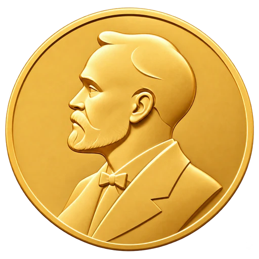
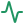
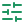

<div align="center">



<h1>Nobel prizes 2016 to 2025 and the case for Lakhdar Brahimi</h1>

<p>A research report on ten years of Nobel prizes, with a teleprompter script for presenting it.<br>Plain HTML, CSS and JavaScript. No framework, no build step.</p>

<p>


</p>

</div>

---

##  About the site

This site is a research report that asks one question: *where are the negotiators?*

Of the ten Nobel Peace Prizes awarded between 2016 and 2025, only two (Colombia in 2016, Ethiopia in 2019) rewarded a negotiated end to a specific conflict. The rest went to people who document, testify and campaign. The report lays out that pattern, covers the science prizes of 2024 and 2025, and then argues the case for Lakhdar Brahimi, the Algerian diplomat who helped broker the Taif Agreement, chaired the Bonn conference and led the panel behind the Brahimi Report on UN peace operations. It also covers where his record is weak.

The project has two parts:

| Page | What it is |
| --- | --- |
 Research report (`/`) | The written report, with a table of the ten Peace Prizes, the science prizes, the case for Brahimi, a career timeline, the counter-arguments and a source list. |
|  Teleprompter (`/script/script`) | A word-for-word spoken script that runs about six and a half minutes. It has pause and emphasis marks, on-screen cues, a timer, an Arabic translation and answers to likely questions. |

##  Features

**Report**

-  Responsive table of ten Peace Prizes that turns into cards on phones
-  Interactive chart that sorts the ten prizes into negotiated settlements and everything else, built from the table itself
-  Map of the nine countries where Brahimi worked, with a readout for each
-  Numbered sources: hover a number in the text to see the source, follow it to the list, and jump back
-  Dark mode that follows the system setting and remembers your choice
-  Science prizes of 2024 and 2025 in plain language
-  Scroll-linked career timeline and reading progress bar
-  Section navigation that follows where you are
-  Skip link, semantic landmarks, focus styles, reduced-motion support

**Teleprompter**

-  Stopwatch against the planned 6:30, with an overtime alert
-  Adjustable text size and a dark reading mode, both remembered
-  One-tap Arabic translation (right-to-left) under every line
-  Live word count and reading time at 130 words a minute
-  Three optional frames with a down arrow, closed by default: the prize chart (Part 1), the mission map (Part 3) and the sources. Each opens with a line to say first, and every year or country button shows the exact line to say for it, with its Arabic translation. The frames are left out of the word count and the 6:30 timing
-  Numbered sources and dark mode, as in the report. Tapping a source number opens the Sources frame and jumps to the source
-  Clean print layout, without the figures

##  Tech stack

| Layer | Choice |
| --- | --- |
| Markup | Semantic HTML5 |
| Styling | Modular vanilla CSS with custom properties |
| Scripting | Native ES modules, no libraries |
| Fonts | Newsreader and Inter, self-hosted (Latin subset, about 105 KB together) |
| Hosting | Vercel, with `cleanUrls` |
| Build | None |

##  Project structure

```
/
├── index.html               Main research report
├── 404.html                 Custom not-found page (served by Vercel for unknown URLs)
├── icon.webp                Favicon (512×512, transparent, ~47 KB)
├── og-image.jpg             Social preview image (1200×630, ~156 KB)
├── icon-192.png, icon-512.png, apple-touch-icon.png   PNG icons for Android and iOS
├── site.webmanifest         Name, colors and icons for installed shortcuts
├── robots.txt, sitemap.xml  Search engine files
├── fonts/                   Newsreader and Inter (woff2) with their OFL licenses
├── vercel.json              cleanUrls on, trailingSlash off
├── LICENSE                  Attribution license
├── README.md
├── .github/icons/           SVG icons used by this README only
├── css/
│   ├── fonts.css            @font-face rules for the self-hosted fonts
│   ├── tokens.css           Palette (light and dark), type stacks, motion and spacing variables
│   ├── base.css             Reset, global type, skip link
│   ├── layout.css           Sticky header, nav, split grids, footer
│   ├── sections.css         Hero, table, science entries, arguments, timeline, footnotes, reveal
│   ├── figures.css          Prize chart, mission map, readout card
│   └── not-found.css        404 page layout
├── js/
│   ├── main.js              Entry point
│   ├── theme.js             Light and dark theme switch
│   ├── chart.js             Builds the prize chart from the table
│   ├── map.js               Mission map pins, chips and readout
│   ├── footnotes.js         Source popovers and back links
│   ├── readout.js           Helpers shared by the chart and the map
│   ├── reveal.js            Scroll-reveal (IntersectionObserver)
│   ├── scroll.js            Progress bar and timeline fill (one rAF loop)
│   ├── nav.js               Active-section highlighting
│   └── not-found.js         Shows the failed address and suggests the closest real page
└── script/
    ├── script.html          Spoken script, Q&A, Arabic translation
    ├── css/
    │   ├── theme.css        Light and reading-mode variables, reset
    │   ├── controls.css     Sticky bar: text size, timer, buttons
    │   ├── content.css      Segments, cues, spoken text, Q&A
    │   └── arabic.css       RTL translation styles and fonts
    └── js/
        ├── app.js           Entry point, reveal, progress, active segment
        ├── metrics.js       Word count and reading time
        ├── settings.js      Text size, reading mode, Arabic toggle, localStorage
        └── timer.js         Stopwatch with overtime alert
```

##  Run locally

ES modules do not load from `file://`, so serve the folder over HTTP:

```bash
npx serve .
# or
python3 -m http.server 8000
```

Open `http://localhost:8000/` and `http://localhost:8000/script/script.html`.

##  Deploy to Vercel

```bash
npm i -g vercel
vercel --prod
```

Or import the repository in the Vercel dashboard. Framework preset: **Other**. No build command; the output directory is the project root.

| File | Live URL |
| --- | --- |
| `index.html` | `/` |
| `script/script.html` | `/script/script` |

### Link previews

The social preview image is `og-image.jpg`, wired up through the Open Graph and Twitter tags in the `<head>` of `index.html`. If you move the site to another domain, update the four `https://peace-by-mediation.vercel.app` URLs there.

After deploying, check the preview with the [Facebook Sharing Debugger](https://developers.facebook.com/tools/debug/) or [LinkedIn Post Inspector](https://www.linkedin.com/post-inspector/). On Telegram, send the link to [@WebpageBot](https://t.me/WebpageBot) to refresh a cached preview.

### Sources and checks

The numbers in the text point to the Sources list. Each number was checked against the page it points to. Eight sources (5, 6, 7, 8, 11, 13, 14 and 20) are listed as further reading and are not cited in the text, because the specific claim could not be confirmed in them. The script page shares the chart, map and footnote code with the report (`/js/chart.js`, `/js/map.js`, `/js/footnotes.js`), and carries a hidden copy of the prize table that feeds its chart. If you edit a prize row, edit it in both pages.

### Custom 404 page

Vercel serves `404.html` for any address that does not exist. It shows the address that failed, and if it looks like a typo of a real page (for example `/scrpt44` or `/script`) it suggests `/script/script`.

##  Performance

-  Native `type="module"` scripts with `modulepreload` for parallel loading
-  Animations use only `transform` and `opacity`
-  One `requestAnimationFrame` loop, passive scroll listeners, reads before writes
-  `IntersectionObserver` for reveals and navigation, not scroll math
-  Favicon cut from 1.2 MB PNG to a 47 KB WebP, and the social image from 2.6 MB to 156 KB
-  Fonts are self-hosted, preloaded and use `font-display: swap`, so there are no third-party requests
-  Cross-page view transitions in supporting browsers, off when reduced motion is requested
-  Saved reading preferences apply before first paint, so there is no flash

##  Customising

- Colors and fonts live in `css/tokens.css` and `script/css/theme.css`.
- To change how long a segment should take, edit `data-target` (in seconds) on its `.seg` in `script/script.html`. The timer limit and the estimates follow.
- To add a nav item, add the link in `index.html`. `nav.js` finds the sections from the links, so the script needs no change.
- To add a Peace Prize row, add a `<tr>` to the table. The chart reads the table, so it updates itself. Give the row `class="rv deal"` if it rewarded a negotiated settlement.
- To change a map pin, edit the `data-when` and `data-text` attributes on its `<g class="pin">` in `index.html`.
- To cite a source, add `<sup class="fn"><a href="#src-N">N</a></sup>` after the claim, where N is the source's number in the list.

##  Browser support

Current Chrome, Edge, Firefox and Safari. Older browsers show the content without animation.

##  License and attribution

© 2026 **Farah Mohamed Amine**. Released under the [Attribution License](LICENSE).

You can use, modify and deploy this project as long as you do three things:

-  Keep the copyright notice and the license text.
-  Credit the author and link to the original repository on any public copy, fork or deployment.
-  Keep the original author's name. You may add your own name for your own changes, but you may not replace or remove the original.

Paste this in your footer and README:

```html
Based on the work of <a href="https://github.com/bxlt3-m/peace-by-mediation">Farah Mohamed Amine</a>
```

##  Author

Written, designed and built by Farah Mohamed Amine.

<div align="center">

<sub>Facts and sources are credited in the page footer. The Nobel Prize name belongs to the Nobel Foundation. Icons by <a href="https://lucide.dev">Lucide</a> (ISC). Fonts Newsreader and Inter (SIL Open Font License). Map data from <a href="https://www.naturalearthdata.com">Natural Earth</a> (public domain), via world-atlas.</sub>

</div>
